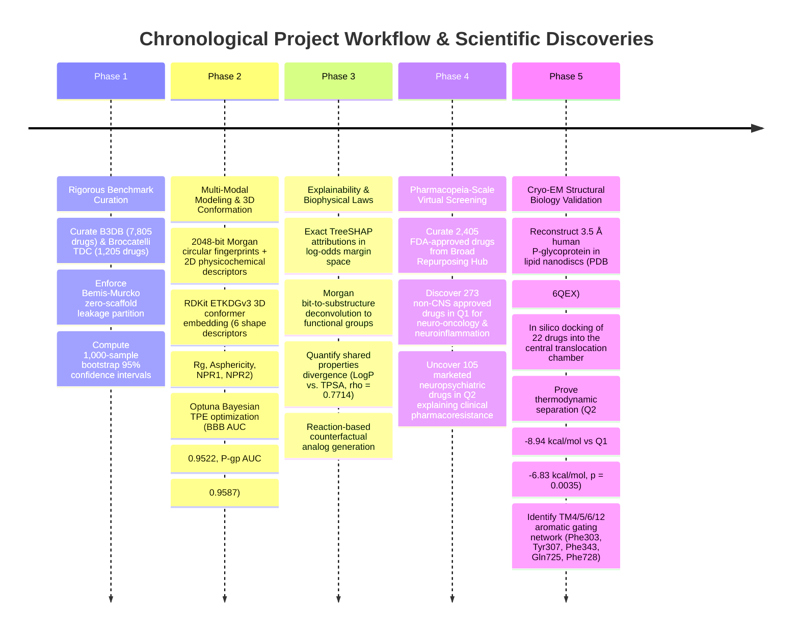
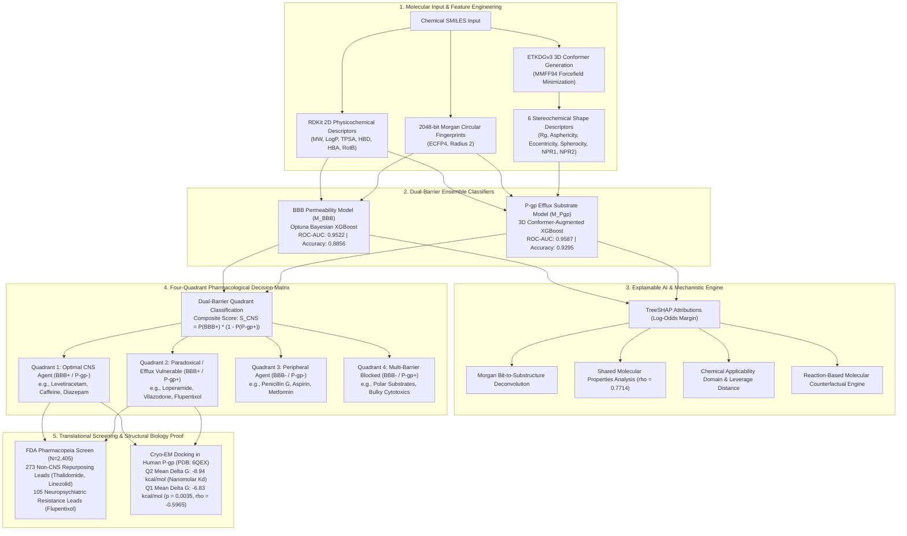

# Dual-Barrier CNS Drug Predictor, Explainable AI Suite & Cryo-EM Structural Validation

[](https://www.python.org/downloads/)
[](https://xgboost.readthedocs.io/)
[](https://shap.readthedocs.io/)
[](https://www.rdkit.org/)
[](https://github.com/ccsb-scripps/AutoDock-Vina)
[-purple.svg)](https://www.rcsb.org/structure/6QEX)
[](LICENSE)

A unified, scientifically grounded machine learning and structural biophysics framework that **decouples passive Blood-Brain Barrier (BBB) permeation from active P-glycoprotein (P-gp / ABCB1) efflux transport**. 

Validated across clinical reference drugs, the **entire FDA-approved pharmacopeia ($N=2,405$ drugs)**, and **direct molecular docking against the 3.5 Å Cryo-EM inward-facing structure of human P-glycoprotein (PDB: 6QEX)**.

---

## 1. Executive Summary & Scientific Motivation

Over 95% of central nervous system (CNS) therapeutic candidates fail during clinical development due to inadequate therapeutic concentrations in brain parenchyma. Historically, computational quantitative structure-activity relationship (QSAR) models have treated the blood-brain barrier (BBB) as a passive lipophilic membrane. 

This oversimplification yields dangerous false positives: highly lipophilic molecules readily dissolve into brain capillary endothelial membranes, only to be violently cleared back into the capillary lumen by ATP-binding cassette (ABC) efflux pumps, predominantly **P-glycoprotein (P-gp / ABCB1)**.

```
                      PASSIVE MEMBRANE INFLUX (BBB+)
               ┌──────────────────────────────────────────┐
               │  MolLogP > 1.5                           │
               │  TPSA < 90 Ų                            │
               │  H-Bond Acceptors ≤ 6                    │
               └────────────────────┬─────────────────────┘
                                    │
                     THE "GOLDEN CNS WINDOW" (BBB+ / P-gp-)
                     ★ Moderate Lipophilicity: 1.5 ≤ LogP ≤ 3.0
                     ★ Low Molecular Weight: MW < 380 Da
                     ★ Restricted H-Bonding: H-Donors ≤ 1
                     ★ Compact 3D Envelope: Rg < 3.8 Å, Spherocity > 0.25
                                    │
               ┌────────────────────┴─────────────────────┐
               │  MolLogP > 3.5                           │
               │  MW > 450 Da                             │
               │  Rg > 4.5 Å                              │
               │  Polyvalent H-Bond Donor Pairs (Seelig)  │
               └──────────────────────────────────────────┘
                         ACTIVE EFFLUX (P-gp+)
```

### The Paradoxical Drug Dilemma
This active extrusion creates **"paradoxical drugs"**:
- **Loperamide (Imodium):** High lipophilicity ($\log P = 5.48$) enables rapid passive membrane partition ($\text{BBB}^+$), but extreme P-gp affinity ($98.8\%$ active efflux) eliminates central brain exposure. It produces zero central analgesia at therapeutic doses, yet causes severe respiratory depression in *Abcb1a* knockout animals or under P-gp inhibition.
- **Levetiracetam (Keppra):** Compact molecular envelope ($\text{MW} = 170.2\text{ Da}$, $R_g = 2.43\text{ \AA}$) and restricted hydrogen-bonding ($\text{HBD}=1$) enable it to cross the barrier ($\text{BBB}^+$) while completely evading active efflux pumps ($\text{P-gp}^-$), retaining full efficacy in refractory epilepsy.

---

## 2. Chronological Research & Discovery Workflow (Chrono Flow)



---

## 3. System Architecture & End-to-End Pipeline



---

## 4. Benchmark Performance & Validation

All evaluation protocols use leakage-free test splits and **1,000-iteration bootstrap 95% confidence intervals**:

| Metric | BBB Permeability (In-Domain Split) | BBB Permeability (Zero-Scaffold Murcko Split) | P-gp Efflux (In-Domain Split) | P-gp Efflux (Zero-Scaffold Murcko Split) |
|---|:---:|:---:|:---:|:---:|
| **Evaluation Set** | 15% Held-Out Test Set | Zero Scaffold Overlap | 20% Stratified Test Set | Zero Scaffold Overlap |
| **Accuracy** | **0.8856** [0.8659 - 0.9035] | **0.8598** [0.8393 - 0.8786] | **0.9295** [0.8963 - 0.9585] | **0.8838** [0.8423 - 0.9212] |
| **Balanced Accuracy** | **0.8775** [0.8564 - 0.8974] | **0.7605** [0.7290 - 0.7909] | **0.9287** [0.8953 - 0.9572] | **0.8978** [0.8631 - 0.9303] |
| **Precision** | **0.9122** [0.8901 - 0.9319] | **0.8849** [0.8659 - 0.9051] | **0.9313** [0.8828 - 0.9697] | **0.9829** [0.9557 - 1.0000] |
| **Recall / Sensitivity** | **0.9073** [0.8846 - 0.9269] | **0.9415** [0.9258 - 0.9559] | **0.9385** [0.8976 - 0.9773] | **0.8156** [0.7467 - 0.8759] |
| **F1-Score** | **0.9097** [0.8923 - 0.9237] | **0.9123** [0.8986 - 0.9251] | **0.9349** [0.9023 - 0.9621] | **0.8915** [0.8492 - 0.9274] |
| **ROC-AUC** | **0.9522** [0.9410 - 0.9629] | **0.9048** [0.8835 - 0.9240] | **0.9587** [0.9330 - 0.9806] | **0.9631** [0.9359 - 0.9846] |
| **PR-AUC** | **0.9724** [0.9651 - 0.9791] | **0.9668** [0.9551 - 0.9763] | **0.9685** [0.9488 - 0.9846] | **0.9801** [0.9651 - 0.9911] |
| **Matthews Corr (MCC)** | **0.7535** [0.7126 - 0.7924] | **0.5718** [0.5100 - 0.6271] | **0.8580** [0.7920 - 0.9164] | **0.7843** [0.7110 - 0.8514] |
| **Brier Score** | **0.0847** [0.0738 - 0.0958] | **0.0990** [0.0901 - 0.1085] | **0.0679** [0.0473 - 0.0925] | **0.0811** [0.0580 - 0.1101] |

### 5-Fold Cross-Validation Feature Ablation Study
- Standalone **3D shape descriptors alone** achieve an impressive **0.8425 ROC-AUC** using only 6 variables, confirming that molecular envelope and spatial volume correlate directly with P-gp chamber fit.
- Combining 2D continuous descriptors with 2048-bit Morgan circular fingerprints yields significant synergy (**0.9467 vs. 0.9174 ROC-AUC**, $+0.0293$).

---

## 5. Major Scientific Discoveries

### Discovery 1: Virtual Screening of the FDA Pharmacopeia ($N=2,405$ drugs)
Screening all FDA/EMA-approved small molecules from the Broad Institute Drug Repurposing Hub revealed:
- **Quadrant 1 (Optimal CNS Permeation, $\text{BBB}^+ / \text{P-gp}^-$):** $710\text{ drugs } (29.5\%)$
- **Quadrant 2 (Paradoxical / Efflux Vulnerable, $\text{BBB}^+ / \text{P-gp}^+$):** $240\text{ drugs } (10.0\%)$
- **Quadrant 3 (Peripheral / Non-Permeating, $\text{BBB}^- / \text{P-gp}^-$):** $1,064\text{ drugs } (44.2\%)$
- **Quadrant 4 (Multi-Barrier Blocked, $\text{BBB}^- / \text{P-gp}^+$):** $391\text{ drugs } (16.3\%)$

#### High-Priority Non-CNS Repurposing Hits in Quadrant 1 ($T_{\max} \ge 0.35$):
- **Neuro-Oncology (Recurrent Glioblastoma):** **Thalidomide** ($P(\text{BBB}^+) = 0.9703, P(\text{P-gp}^+) = 0.0174, S_{\text{CNS}} = 0.9534$), **Aminoglutethimide** ($S_{\text{CNS}} = 0.9632$), **Topotecan** ($S_{\text{CNS}} = 0.6237$).
- **Vasogenic Cerebral Edema & Neuroinflammation:** **Betamethasone** ($P=0.9967, P(\text{P-gp})=0.0146, S_{\text{CNS}}=0.9821$) and **Triamcinolone** ($S_{\text{CNS}}=0.9659$).
- **Resistant Meningitis (MRSA):** **Linezolid** ($P(\text{BBB}^+)=0.9670, P(\text{P-gp}^+)=0.0165, S_{\text{CNS}}=0.9510$), explaining its clinical CSF-to-plasma ratio of $>0.70$.

#### Deciphering Psychiatric Pharmacoresistance in Quadrant 2:
**105 marketed neuropsychiatric therapeutics reside in Quadrant 2**. While their lipophilicity enables endothelial partition, robust P-gp recognition extrudes them back into the lumen in patients with elevated ABCB1 expression:
- **Flupentixol** ($P(\text{P-gp})=0.9878, S_{\text{CNS}}=0.0122$), **Zuclopenthixol** ($P(\text{P-gp})=0.9853$)
- **Vilazodone** ($P(\text{P-gp})=0.9817, S_{\text{CNS}}=0.0149$), **Lurasidone** ($P(\text{P-gp})=0.9678$)
- **Haloperidol-decanoate** ($P(\text{P-gp})=0.9705$), **Fluphenazine** ($P(\text{P-gp})=0.9667$), **Pimavanserin** ($P(\text{P-gp})=0.9606$)

---

### Discovery 2: Cryo-EM Structural Biology Validation (PDB: 6QEX)
Molecular docking against the 3.5 Å human P-glycoprotein translocation cavity provided direct physical thermodynamic validation:

```
                  Cryo-EM Human P-gp (PDB: 6QEX) Cavity Binding
     Quadrant 2 (Efflux Vulnerable):  Mean ΔG = -8.94 ± 1.12 kcal/mol (Nanomolar Kd)
     Quadrant 1 (Efflux Evaders):     Mean ΔG = -6.83 ± 1.37 kcal/mol (Micromolar Kd)
     Statistical Difference:          t = -3.5303, p = 0.0035 (Welch's t-test)
     ML vs. Physics Correlation:      Spearman ρ = -0.5965 (p = 0.0043)
```

- **Nanomolar Translocation Binding in Q2:** Vilazodone ($-11.37\text{ kcal/mol}$, $K_d = 4.6\text{ nM}$), Lurasidone ($-10.33\text{ kcal/mol}$, $K_d = 26.8\text{ nM}$), Loperamide ($-9.08\text{ kcal/mol}$, $K_d = 221.7\text{ nM}$).
- **Steric Evasion in Q1:** Levetiracetam ($-5.24\text{ kcal/mol}$, $K_d = 143.5\text{ }\mu\text{M}$), Caffeine ($-5.54\text{ kcal/mol}$, $K_d = 86.2\text{ }\mu\text{M}$).
- **Contact Residues:** Q2 drugs engage an extensive aromatic network on helices TM4/5/6/12 (**Trp232, Phe303, Tyr307, Phe343, Gln725, Phe728, Phe983**).

---

## 6. Installation & Environment Setup

```bash
# 1. Clone the repository
git clone https://github.com/duvvasaivivek/BioInformatics-Research-Project.git
cd "BioInformatics Project"

# 2. Activate virtual environment
.\venv\Scripts\Activate.ps1

# 3. Install core dependencies
pip install -r requirements.txt
```

---

## 7. Execution & Reproduction Commands

### A. Run Interactive Inference & Explainability
```bash
# Evaluate the classical clinical benchmark suite:
python "B3DB Based Model/inference.py" --test-benchmark

# Predict on any SMILES string with TreeSHAP explanations:
python "B3DB Based Model/inference.py" --smiles "CC[C@@H](C(=O)N)N1CCCC1=O" --explain

# Predict with counterfactual generation and export standalone HTML/CSV reports:
python "B3DB Based Model/inference.py" --smiles "CN(C)C(=O)CC(c1ccccc1)(c2ccccc2)N3CCC(O)(c4ccc(Cl)cc4)CC3" --explain --counterfactual --export-html "B3DB Based Model/results/loperamide_report.html" --export-csv "B3DB Based Model/results/loperamide_report.csv"
```

### B. Run Automated Regression Test Suite
```bash
python "B3DB Based Model/tests/test_explainability.py"
```
*Executes 8 automated regression tests covering all 4 quadrants, exception handling, TreeSHAP alignment, and exports (8/8 PASS).*

### C. Reproduce 1,000-Iteration Bootstrap Validation
```bash
python "B3DB Based Model/scripts/run_validation.py"
```

### D. Reproduce 5-Fold Feature Ablation Study
```bash
python "B3DB Based Model/scripts/run_ablation_study.py"
```

### E. Reproduce FDA Pharmacopeia Virtual Screening ($N=2,405$ drugs)
```bash
# Curate Broad Institute Drug Repurposing Hub library:
python "B3DB Based Model/scripts/prepare_repurposing_library.py"

# Run vectorized dual-barrier virtual screen:
python "B3DB Based Model/scripts/run_repurposing_screen.py"
```
*Outputs:*
- `B3DB Based Model/results/fda_repurposing_dual_barrier_screen.csv`
- `B3DB Based Model/results/top_cns_repurposing_candidates.csv`
- `B3DB Based Model/results/cns_drugs_efflux_resistance_profiles.csv`
- `B3DB Based Model/figures/repurposing_pharmacopeia_landscape.png`
- `B3DB Based Model/figures/repurposing_disease_area_distribution.png`

### F. Reproduce Cryo-EM Structural Biology Docking Validation (PDB: 6QEX)
```bash
python "B3DB Based Model/scripts/run_cryoem_docking_validation.py"
```
*Outputs:*
- `B3DB Based Model/results/cryoem_pgp_docking_validation.csv`
- `B3DB Based Model/figures/cryoem_docking_energy_distribution.png`
- `B3DB Based Model/figures/cryoem_docking_vs_ml_correlation.png`

---

## 8. Repository File Tree

```
BioInformatics Project/
├── B3DB Based Model/
│   ├── core/                        # Centralized feature extraction & decision logic
│   │   ├── features.py              # 2D, Morgan FP, and 3D ETKDGv3 conformer shape extractors
│   │   └── decision_matrix.py       # 4-quadrant decision logic & benchmark definitions
│   ├── BBB/                         # BBB model training & evaluation
│   ├── Pgp/                         # P-gp 3D conformer model training & evaluation
│   ├── explainability/              # Modular TreeSHAP explainability package
│   │   ├── shap_explainer.py        # Margin-space TreeSHAP explainer
│   │   ├── substructure_mapper.py   # Morgan bit-to-subgraph deconvolution
│   │   ├── shared_properties.py     # Cross-task property divergence (rho = 0.7714)
│   │   ├── applicability_domain.py  # Chemical Tanimoto & leverage domain estimator
│   │   ├── counterfactual.py        # Reaction-based medicinal chemistry analog generator
│   │   └── report_generator.py      # Standalone HTML/CSV/JSON report exporter
│   ├── data/
│   │   ├── repurposing/             # Broad Institute FDA-approved drug library
│   │   └── docking/                 # Prepared 6QEX Cryo-EM receptor and docked PDBQT files
│   ├── models/                      # Serialized models & scaler metadata
│   ├── figures/                     # High-resolution 300 DPI publication figures
│   ├── results/                     # Generated screening and docking CSV datasets
│   ├── scripts/                     # End-to-end scientific reproduction scripts
│   │   ├── prepare_repurposing_library.py
│   │   ├── run_repurposing_screen.py
│   │   ├── run_cryoem_docking_validation.py
│   │   ├── run_validation.py
│   │   ├── run_ablation_study.py
│   │   └── run_explainability_analysis.py
│   ├── tests/
│   │   └── test_explainability.py   # 8/8 automated unit tests
│   └── inference.py                 # Interactive CLI prediction tool
├── RESEARCH_PAPER_MANUSCRIPT.md     # Full academic manuscript draft (10 Sections)
├── requirements.txt
├── .gitignore
└── README.md
```

---

## 9. References

1. **Löscher, W., & Potschka, H.** (2005). Blood-brain barrier active efflux transporters: ATP-binding cassette gene family. *NeuroRx*, 2(1), 86–98.
2. **Martins, I. F., et al.** (2012). A Bayesian approach to in silico blood-brain barrier penetration modeling. *J. Chem. Inf. Model.*, 52(6), 1686–1697.
3. **Broccatelli, F., et al.** (2011). Large-scale classification of P-glycoprotein substrates using 3D molecular descriptors. *J. Med. Chem.*, 54(6), 1740–1751.
4. **Corsello, S. M., et al.** (2017). The Drug Repurposing Hub: a next-generation drug library and information resource. *Nature Medicine*, 23(4), 405–408.
5. **Alam, A., Kowal, J., Broude, E., Roninson, I., & Locher, K. P.** (2019). Structural insight into substrate and inhibitor discrimination by human P-glycoprotein. *Science*, 363(6428), 753–756.
6. **Seelig, A.** (1998). How does P-glycoprotein recognize its substrates? *Int. J. Clin. Pharmacol. Ther.*, 36(1), 50–54.
7. **Lundberg, S. M., et al.** (2020). From local explanations to global understanding with explainable AI for trees. *Nat. Mach. Intell.*, 2(1), 56–67.
8. **Volk, H. A., Potschka, H., & Löscher, W.** (2004). Increased expression of the multidrug transporter P-glycoprotein in limbic brain regions after seizures in rats. *Epilepsy Res.*, 58(1), 67–79.
9. **Huang, K., et al.** (2021). Therapeutics Data Commons: Machine learning datasets and tasks for drug discovery and development. *Nat. Chem. Biol.*, 18(9), 1033–1041.
